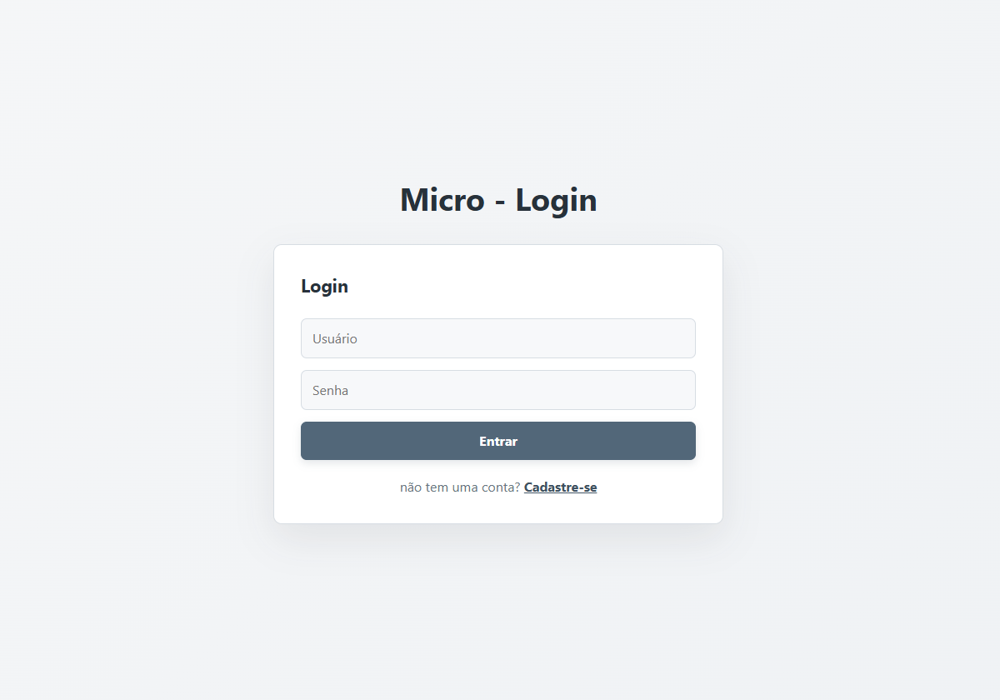
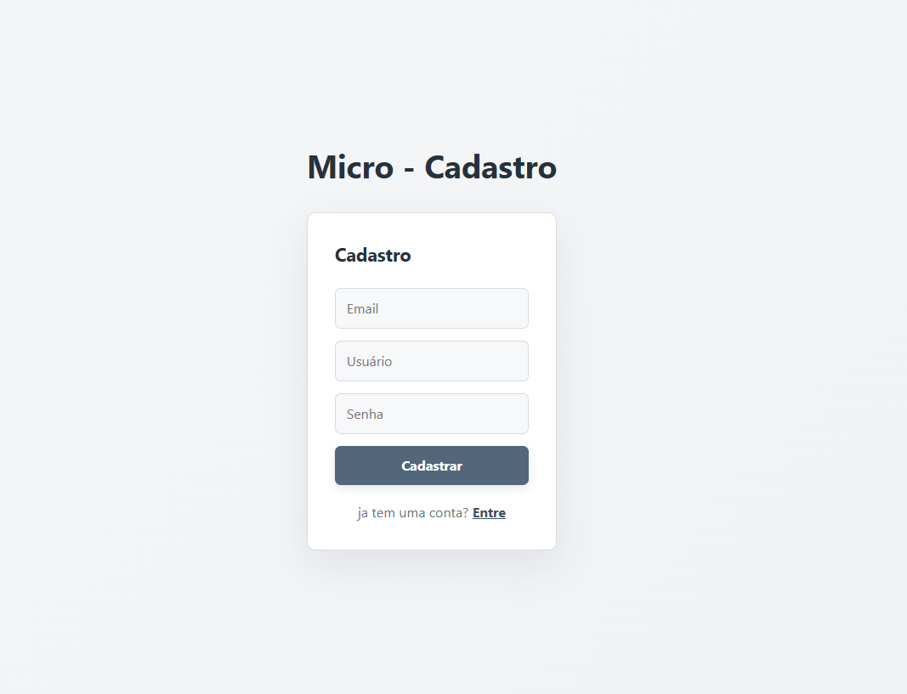
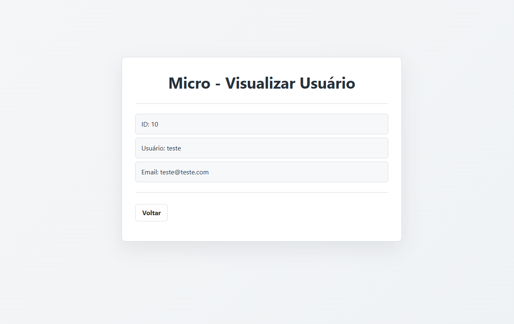
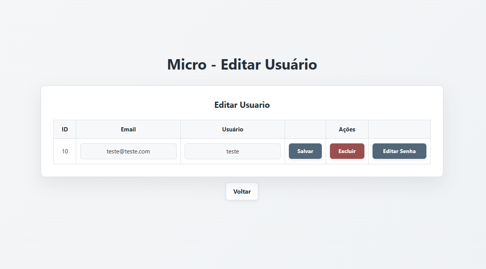
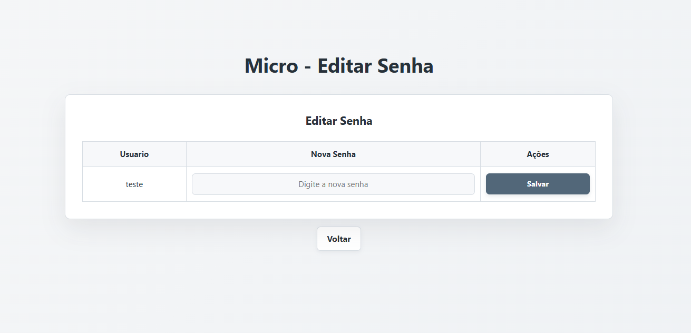
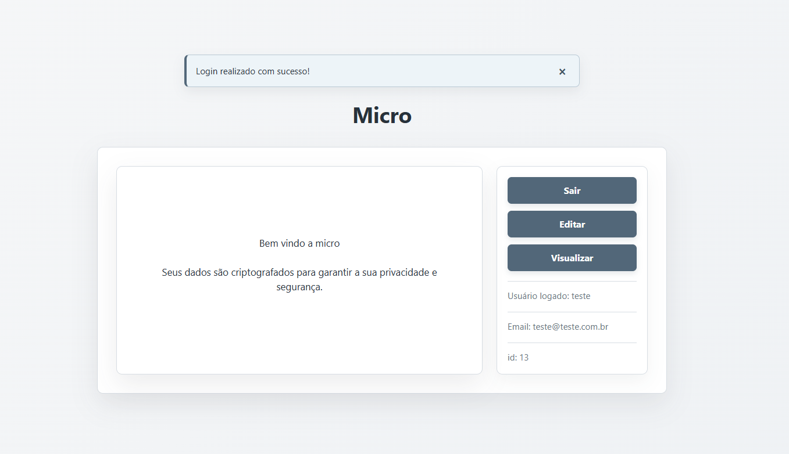
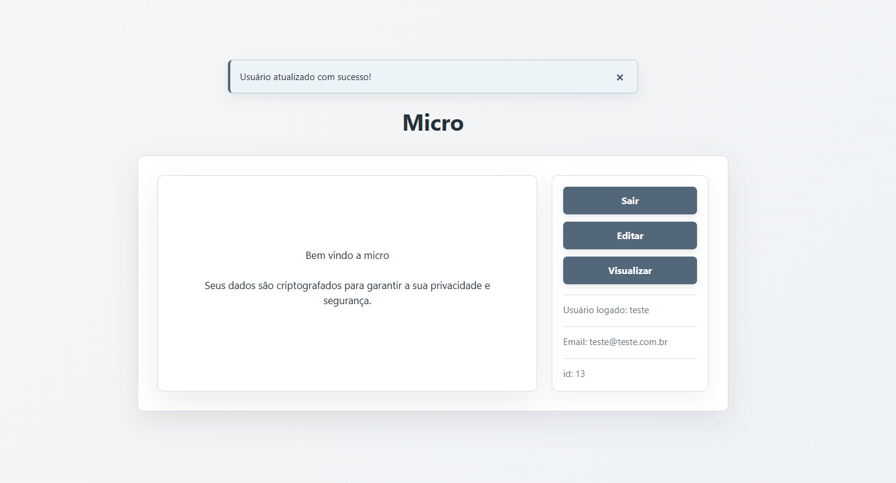

# Micro - CRUD de Login e Senha

Aplicação PHP para cadastro e gerenciamento de usuários. O projeto permite criar uma conta, entrar no sistema, visualizar os dados do usuário, editar cadastro, alterar senha e excluir o registro.

## Visão geral

O fluxo principal da aplicação é:

1. O usuário acessa a tela de login.
2. Caso ainda não tenha uma conta, realiza o cadastro.
3. Após o login, é direcionado para a página principal.
4. Na página principal, pode visualizar, editar ou excluir seus dados.
5. A senha pode ser alterada em uma tela própria.
6. O logout encerra a sessão e retorna ao login.

## Telas do projeto

### Login

A tela inicial recebe o usuário e a senha. O formulário envia os dados para `acoes.php` usando o campo `login`.



### Cadastro

Permite criar um novo usuário informando email, nome de usuário e senha. A senha é convertida em hash com `password_hash` antes de ser salva no banco.



### Página principal

Depois do login, a aplicação consulta o usuário armazenado na sessão e exibe as opções de gerenciamento.


### Visualização

Exibe o ID, usuário e email cadastrados sem permitir edição direta.



### Edição do cadastro

Permite atualizar o email e o nome de usuário. Também apresenta as ações de exclusão e alteração de senha.



### Edição de senha

Tela específica para informar e salvar uma nova senha para o usuário selecionado.



## Avisos do sistema

Após cada ação, o sistema informa ao usuário se a operação foi concluída ou se ocorreu algum problema. Esses avisos são exibidos no topo da página de destino e podem ser fechados pelo botão `X`.





### Como os avisos funcionam

1. O formulário envia a ação para `acoes.php` usando o método `POST`.
2. `acoes.php` grava o texto do resultado em `$_SESSION['mensagem']`.
3. Após o processamento, o usuário é redirecionado para a página correspondente.
4. `mensagem.php` verifica se existe uma mensagem na sessão e exibe o aviso.
5. Depois da exibição, a mensagem é removida da sessão para não aparecer novamente ao atualizar a página.

As mensagens podem indicar sucesso, como login realizado, cadastro concluído ou senha atualizada, e também erros, como senha incorreta, usuário não encontrado ou falha no banco de dados.

## Tecnologias utilizadas

- PHP
- MySQL/MariaDB
- HTML5
- CSS3
- Apache, por meio do WAMP
- MySQLi para conexão com o banco

## Estrutura de pastas

```text
crud-login-senha/
├── acoes.php                 # Processa login, cadastro, edição, exclusão e logout
├── index.php                 # Tela de login
├── cadastro.php              # Tela de cadastro
├── pagina.php                # Página principal após o login
├── visualizar.php            # Visualização dos dados do usuário
├── editar.php                # Edição de email e usuário
├── editar_senha.php          # Alteração da senha
├── assets/
│   ├── css/                  # Folhas de estilo das telas
│   └── img/                  # Imagens usadas neste README e no projeto
├── banco/
│   └── registro_login.sql    # Script de criação do banco e tabela
└── config/
    └── conexao.php           # Configuração da conexão MySQL
```

## Requisitos

- WAMP, XAMPP ou outro ambiente com Apache, PHP e MySQL/MariaDB.
- PHP com a extensão `mysqli` habilitada.
- Navegador atualizado.

## Instalação no WAMP

1. Copie a pasta `crud-login-senha` para:

   ```text
   C:\wamp64\www\
   ```

2. Inicie os serviços **Apache** e **MySQL** no WAMP.

3. Abra o phpMyAdmin em `http://localhost/phpmyadmin`.

4. Execute o conteúdo do arquivo `banco/registro_login.sql`. O script cria:

   - Banco: `registro_login`
   - Tabela: `logins`
   - Colunas: `id`, `email`, `usuario` e `senha`

5. Confira a conexão em `config/conexao.php`:

   ```php
   $host = "localhost";
   $usuario = "root";
   $senha = "";
   $banco = "registro_login";
   ```

   Ajuste o usuário, a senha ou o nome do banco caso sua instalação do MySQL seja diferente.

6. Acesse no navegador:

   ```text
   http://localhost/crud-login-senha/
   ```

## Como o processamento funciona

Os formulários das páginas enviam requisições `POST` para `acoes.php`. O arquivo identifica a ação pelo nome do botão ou campo enviado:

| Ação | Campo enviado | Resultado |
| --- | --- | --- |
| Login | `login` | Valida usuário e senha e redireciona para `pagina.php` |
| Cadastro | `cadastrar` | Insere um novo usuário e retorna para `index.php` |
| Logout | `logout` | Encerra a sessão e retorna para `index.php` |
| Editar usuário | `editar` | Atualiza email e nome de usuário |
| Excluir usuário | `excluir` | Remove o registro pelo ID |
| Editar senha | `id-senha` | Seleciona o usuário e abre `editar_senha.php` |
| Salvar senha | `editar-senha` | Gera um novo hash e atualiza a senha |

## Banco de dados

O script `banco/registro_login.sql` cria a tabela abaixo:

```sql
CREATE TABLE logins (
    id INT AUTO_INCREMENT PRIMARY KEY,
    email VARCHAR(100) NOT NULL,
    usuario VARCHAR(100) NOT NULL,
    senha VARCHAR(100) NOT NULL
);
```

As senhas não são armazenadas em texto puro durante o cadastro e na alteração de senha. O login compara a senha informada com o hash salvo usando `password_verify`.

## Fluxo de sessão

- O ID e o nome do usuário autenticado ficam disponíveis em `$_SESSION`.
- A página principal utiliza o ID da sessão para buscar os dados no banco.
- A edição de senha também usa o ID armazenado na sessão.
- O logout chama `session_destroy()` e redireciona para a tela inicial.

## Observações

- O projeto foi desenvolvido para execução local em ambiente WAMP.
- O arquivo `config/conexao.php` usa, por padrão, o usuário `root` sem senha, configuração comum em instalações locais.
- Antes de publicar em produção, recomenda-se adicionar validação de autorização em cada tela, proteção contra CSRF, mensagens de erro controladas e credenciais de banco fora dos arquivos públicos.
